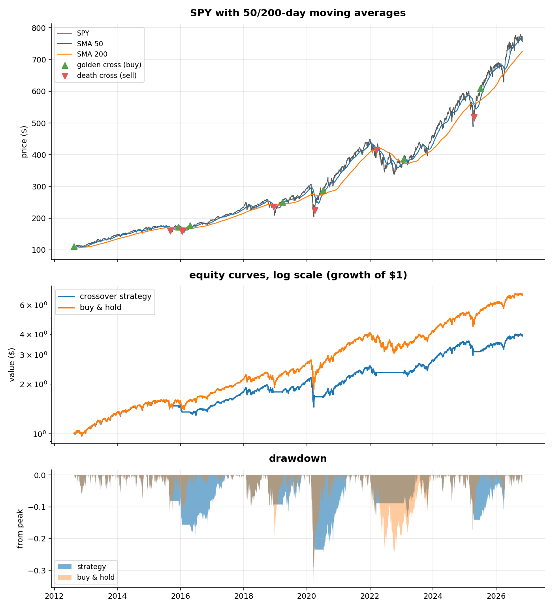

# 50/200 moving average crossover backtest

The golden cross: hold SPY while its 50-day average is above the 200-day,
sit in cash otherwise. Fifteen years of data.

The rule is trivial; testing it honestly is the project:

* **No lookahead** - every signal is delayed one day; you act on
  yesterday's cross at today's close.
* **Costs** - 10 bps charged on every switch between invested and cash.
* **Benchmark** - judged against simply buying and holding.

## Run

```sh
python ma_crossover.py                     # SPY, 15y, 50/200
python ma_crossover.py --ticker QQQ --fast 20 --slow 100 --cost 0.002
```

## Results (SPY, 15y)

| Metric | Strategy | Buy & hold |
|--------|----------|------------|
| Total return | +289% | +586% |
| CAGR | 10.1% | 14.6% |
| Ann. volatility | 14.3% | 16.6% |
| Sharpe | 0.74 | 0.90 |
| Max drawdown | -33.7% | -33.7% |
| Switches | 13 | - |
| Time in market | 85% | 100% |

The honest answer: over this bull-heavy sample the rule loses to doing
nothing. It exits late in fast crashes (2020's death cross printed near the
bottom) and gets whipsawed in sideways years, while only avoiding a slice
of the slow 2022 bear. This is what transaction costs and no-lookahead
testing do to most published "simple" strategies - which is exactly why the
benchmark matters.



## Limits

Single asset, single parameter pair; results are sample-dependent and say
little about other decades. Cash earns 0% here (generous to neither side in
real terms, ungenerous to the strategy in high-rate years).
