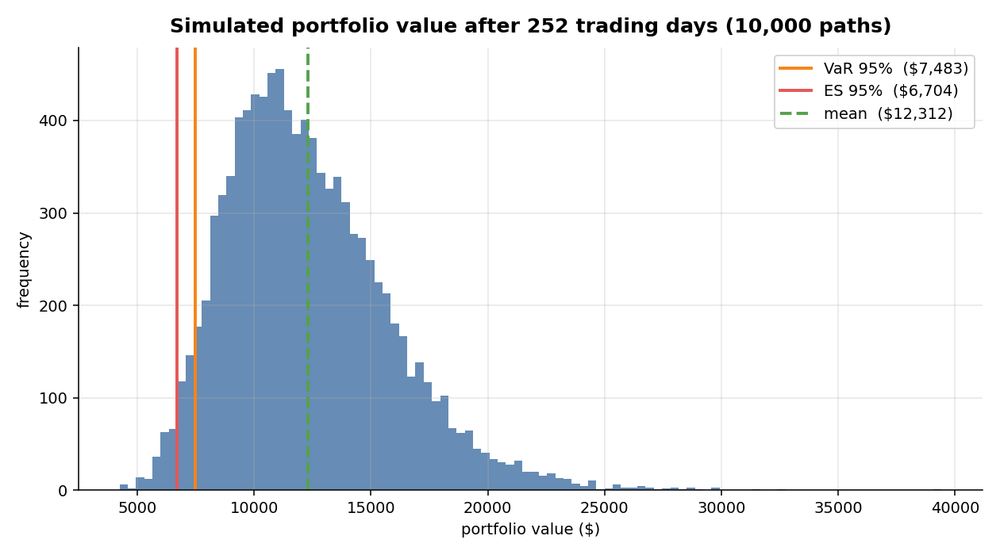
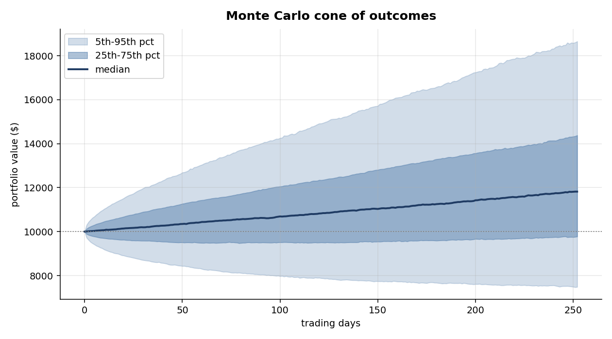

# Monte Carlo portfolio risk

How much can this portfolio lose in a year? Estimate drift and covariance
from five years of daily log returns, simulate 10,000 correlated one-year
paths (geometric Brownian motion, Cholesky-decomposed covariance, daily
rebalancing to equal weights), then read the tail off the distribution:

* **VaR 95%** - the loss only 5% of simulated years exceed
* **Expected shortfall (CVaR) 95%** - the average of that worst 5%

Default portfolio: equal-weight AAPL / MSFT / GOOGL / NVDA, $10,000 start.

## Run

```sh
python monte_carlo.py                      # 10k paths, seeded (reproducible)
python monte_carlo.py --tickers AAPL TSLA --sims 50000 --days 126
```

## Results (default run, seed 42)

| Metric | Value |
|--------|-------|
| Expected value after 1y | $12,312 |
| Median value after 1y | $11,819 |
| **VaR 95%** | **-$2,517** |
| **Expected shortfall 95%** | **-$3,296** |
| VaR 99% | -$3,788 |
| Expected shortfall 99% | -$4,338 |
| Probability of a losing year | 27.8% |




## Limits

GBM returns are log-normal with constant volatility and correlation. Real
markets have fat tails (2008, 2020 are many-sigma under this model) and
correlations converge to 1 in a crash, so treat these tail numbers as a
floor, not a ceiling. Estimating drift from five years of history is also
notoriously noisy - the VaR side is far more stable than the mean side.
