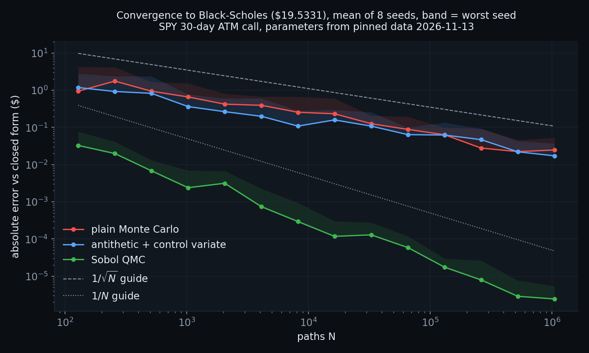
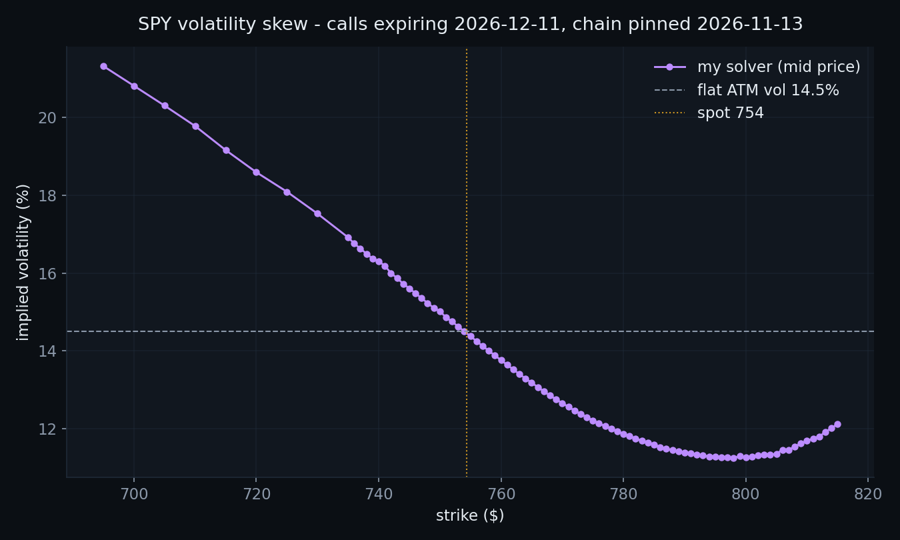

# options-pricer

Black-Scholes closed form vs three Monte Carlo estimators, checked against each other and against a real, pinned SPY option chain.

Live interactive version: https://aditya2375.github.io/quant-lab/options.html

## What it does

- Prices a European call/put with the closed-form Black-Scholes-Merton formula, with full analytic Greeks (delta, gamma, vega, theta per day, rho).
- Prices the same contract with Monte Carlo under geometric Brownian motion, in three ways: plain sampling, antithetic variates + control variate, and scrambled Sobol quasi-Monte Carlo. Each estimate comes with a standard error and a 95% confidence interval, so "do they agree?" is answered with statistics, not eyeballing.
- Runs a convergence study: absolute error vs the closed form from 128 to 1,048,576 paths, averaged over 8 independent seeds, with the worst seed shown as a band.
- Verifies put-call parity to machine precision and round-trips implied volatility through a bisection solver.
- Inverts Black-Scholes on a real SPY call chain (89 liquid strikes, expiring 2026-12-11, pinned to `data/raw/SPY-options-2026-12-11-calls.csv` with a sha256 in `data/manifest.json`) to draw the volatility skew, and prices every strike at one flat vol to show exactly where the flat model is wrong.

## Headline result (all inputs pinned)

Contract: SPY 30-day ATM call, spot 754.37, strike 755, sigma = 22.03% (21-day realized close-to-close vol of SPY, annualized, as of 2026-11-13), r = 4% (assumption), q = 1.2% (assumption).

- Closed form: $19.5331
- Monte Carlo, 2^20 paths, antithetic + control: $19.5203 +/- $0.039 (95% CI). The closed form sits inside the interval.
- Sobol QMC reaches a $0.000002 absolute error at 2^20 paths, about 3,000x tighter than plain Monte Carlo at the same path count.
- Put-call parity residual: 0.0. Implied-vol round-trip error: 2e-11.
- My implied-vol solver vs the chain provider's IVs: median absolute difference 0.69 vol points across 89 strikes (the tails with stale quotes differ more; mids agree closely).

## What the convergence study actually shows



Mean absolute error over 8 seeds, band = worst seed. Plain MC decays like 1/sqrt(N), as theory says. Antithetic + control variate gives a modest constant-factor win on this at-the-money call (the control variate is the discounted terminal price; its correlation with an ATM payoff is good but not great). Sobol QMC decays close to 1/N because the 1-D integrand is smooth, and it is the clear winner here. The honest caveat: QMC's edge shrinks in high dimensions or with discontinuous payoffs, and no estimator fixes a wrong model.

## The skew: where flat-sigma Black-Scholes breaks



Implied vol from my own solver on the pinned chain. OTM puts (left side, shown through their parity-equivalent ITM calls) trade at ~21% implied vol while ATM sits at ~14.5%. One flat sigma cannot price the whole chain: at K=695 the flat-ATM-vol price is $1.28 under the market mid, at K=815 it is $0.26 over. This is the market pricing crash risk that a log-normal model says barely exists, and it is the reason volatility forecasting (the sibling study in this repo) matters at all.

## Run it

```
pip install -r requirements.txt
python3 options-pricer/options_pricer.py    # writes docs/data/options-pricer.json + output/summary.json
python3 -m unittest discover -s tests        # 20+ checks against the closed form
```

## Honest limits

GBM assumes constant vol, continuous hedging, no jumps, no transaction costs. Real SPY returns have fat tails and vol clustering (quantified in the vol-forecaster study), which is exactly why the skew above exists. Prices here are model prices, not fair value, and nothing here is investment advice. The interest rate and dividend yield are stated assumptions, not fetched data.
