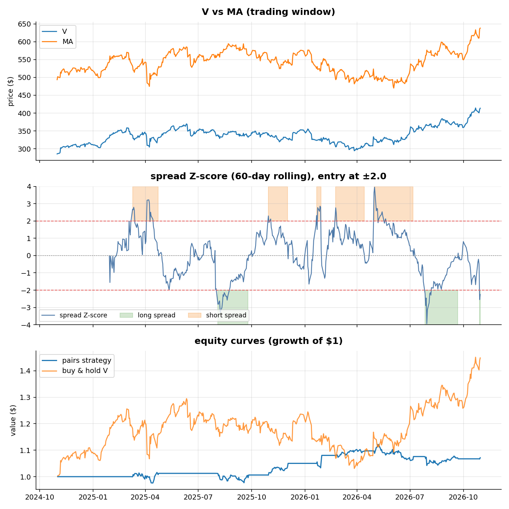

# Pairs trading (statistical arbitrage)

Find two stocks whose prices move together, bet on the gap between them
closing.

1. **Screen.** The pair must pass the Engle-Granger cointegration test on a
   3-year formation window. Most famous "obvious" pairs fail it today:
   KO/PEP (p = 0.83), XOM/CVX (p = 0.84), JPM/BAC (p = 0.99). V/MA passes
   (p = 0.01) and is the default.
2. **Model.** OLS of log V on log MA over the formation window gives the
   hedge ratio (0.90). The spread is `V - hedge * MA`.
3. **Trade (out of sample).** On the remaining 2 years, track the spread's
   60-day rolling Z-score. Long the spread at -2, short at +2, exit at the
   mean. 5 bps cost per position change; the hedge ratio never sees the
   trading window.

## Run

```sh
python pairs_trading.py                    # V vs MA, 5y history
python pairs_trading.py --pair KO PEP --entry 2.5 --z-window 40
```

The script prints a loud warning and marks the run as unsound if the pair
fails the cointegration test - trading a non-cointegrated pair is a coin
flip.

## Results (V/MA, 2y out of sample)

| Metric | Strategy | Buy & hold V |
|--------|----------|--------------|
| Total return | +7.1% | +44.8% |
| CAGR | 3.5% | - |
| Ann. volatility | 6.8% | - |
| Sharpe | 0.55 | - |
| Max drawdown | -7.1% | - |
| Position changes | 15 | - |
| Time in market | 44% | - |

A market-neutral book won't beat a bull market - the point is the profile:
positive carry at a fraction of the volatility and drawdown.



## Limits

Cointegration is a historical property, not a law; it breaks when business
models diverge (or one leg gets acquired). Results are sensitive to the
entry threshold and z-score window, and the dollar-neutral return
approximation ignores margin and borrow costs on the short leg.
